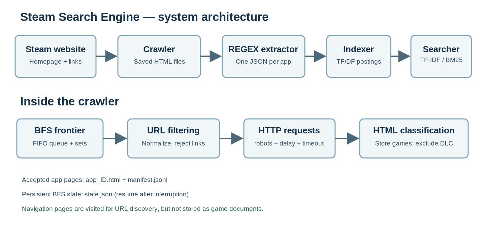

# First Project Submission — Steam Search Engine

**Course:** Information Retrieval  
**Submission:** First part of the project, 28 October 2026  
**Project:** Steam Search Engine (Python)

This report follows the mandatory points of the first project submission. The demonstration uses the completed crawl `run_20261027T235528Z_676afa` unless otherwise stated.

## 1. Project description and objective

The goal is to create a local search engine for Steam games. The crawler discovers and downloads public Steam store pages; the REGEX extractor converts saved HTML into JSON documents; the indexer builds a vocabulary and an inverted index; and the searcher returns ranked matches using two weighting models. The main focus is implementing and understanding the retrieval pipeline, not developing a conversational chatbot.

## 2. Crawled pages and five extracted examples

**Source:** [Steam Store](https://store.steampowered.com/). The crawl starts at the store homepage and follows supported game, genre, category and tag links. The crawler stores accepted `/app/ID/` pages. Examples from actual HTML/JSON files:

| Steam product page | AppID | Extracted developer(s) | Extracted genre(s) |
|---|---|---|---|
| [Counter-Strike 2](https://store.steampowered.com/app/730/) | `730` | Valve | Action, Free To Play |
| [Dota 2](https://store.steampowered.com/app/570/) | `570` | Valve | Action, Strategy, Free To Play |
| [Valheim](https://store.steampowered.com/app/892970/) | `892970` | Iron Gate AB | Action, Adventure, Indie |
| [Enshrouded](https://store.steampowered.com/app/1203620/) | `1203620` | Keen Games GmbH | Action, Adventure, Indie |
| [Castlevania: Belmont's Curse](https://store.steampowered.com/app/4231820/) | `4231820` | KONAMI, Evil Empire | Action, RPG |

For each document, the extractor stores `app_id`, canonical `url`, `title`, `developer`, `publisher`, `release_date`, `genres`, `tags`, `features`, `short_description`, `full_description`, and `supported_languages`. A matching HTML and JSON file use the same application ID (for example `app_730.html` and `app_730.json`). These five examples were obtained from actual saved Steam HTML files.

## 3. Five example user questions and expected answers

The system is a **keyword search engine**: it returns ranked game titles and URLs rather than generating a written answer. The following are *intended user scenarios* (expected matches, not claims that each was experimentally ranked first):

| User question / search intent | Suggested keyword query | Expected relevant answer |
|---|---|---|
| Which Valve game is a competitive first-person shooter? | `counter strike competitive shooter` | Counter-Strike 2 |
| Which multiplayer game involves heroes and strategy? | `dota heroes strategy` | Dota 2 |
| Which game offers Viking-themed survival and exploration? | `viking survival exploration` | Valheim |
| Which game combines action and cooperative mining? | `dwarves mining co-op` | Deep Rock Galactic |
| Which roguelike focuses on cards and deck building? | `roguelike cards deckbuilding` | Slay the Spire |

## 4. Frameworks, libraries and reasons

| Tool or library | Reason for use |
|---|---|
| Python 3.10+ | Main programming language; standard data structures and file I/O |
| `requests` | HTTP requests with session headers and timeout handling |
| `beautifulsoup4` | Discover `<a href>` links **in the crawler only** |
| `urllib.robotparser` | Parse and check `robots.txt` |
| `collections.deque`, `set` | Efficient BFS queue and URL deduplication |
| Python `re` | Implement REGEX-based entity extraction from HTML |
| `json`, `pathlib`, `collections.Counter`, `math` | Saved documents, file paths, token counts, TF/DF and ranking formulas |

No external indexing or search-ranking engine is used. The extractor does not use BeautifulSoup for entity extraction.

## 5. Crawling architecture



The single-worker crawler uses BFS from `https://store.steampowered.com/`. It normalizes URLs, avoids duplicates using known/visited sets and filters obvious unwanted product links before queueing. It checks robots rules and downloads HTML sequentially. After download it classifies product pages and stores accepted game HTML. Navigation pages are followed for discovery but not stored as game documents. The crawler records events and saves its queue and counters in `state.json`, allowing a run to resume.

The four main software components are `SteamCrawler`, `SteamExtractor`, `SteamIndexer` and `SteamSearcher`.

## 6. Metadata saved while crawling

The crawler stores accepted product pages as `app_ID.html`. Its `manifest.jsonl` stores one JSON event per processed URL, including metadata. This is one **real record from a previously verified run**, which uses the same event format as the final run:

| Metadata field | Example value | Purpose |
|---|---|---|
| `url` | `https://store.steampowered.com/app/4287040/?l=english` | Source URL |
| `result` | `saved` | Download outcome |
| `file` | `app_4287040.html` | Local filename |
| `app_id` | `4287040` | Steam application identifier |
| `title` | `Vampy's Big Day` | Name recognized by the crawler |
| `size_bytes` | `129182` | Size of saved HTML |
| `timestamp_utc` | `2026-10-27T21:12:40.422008+00:00` | Processing timestamp |

`stats.json` contains totals; `state.json` contains the BFS frontier, visited/known URLs, counters and product-type exclusions. The extractor generates a separate JSON record containing game attributes.

## 7. HTTP headers, timeout and request delay

Configured in `crawler/config.py`:

| Setting | Value in submitted configuration | Reason |
|---|---|---|
| `User-Agent` | `IRStudentCrawler/0.1 (university educational project)` | Identifies the crawler's purpose |
| `Accept-Language` | `en-US,en;q=0.9` | Prefer consistent English-language content |
| Timeout | 20 seconds | Avoid indefinitely hanging on a request |
| Delay | 2 seconds between requests | Limit request frequency; previous runs used 4 seconds |
| `robots.txt` | `https://store.steampowered.com/robots.txt` | Check whether a URL may be visited |
| Redirects | Disabled | Avoid following an unexpected redirect automatically |

The crawler stops when it cannot verify `robots.txt`. HTTP 403/429 also stop the crawl to avoid repeatedly requesting denied pages.

## 8. Real source code: extracting URLs from HTML

This is the actual function in `crawler/crawler.py` (not pseudocode):

```python
def extract_links(html: bytes, base_url: str) -> list[tuple[str, str, str]]:
    """Discover supported links, keeping their labels for pre-queue filtering."""
    soup = BeautifulSoup(html, "html.parser")
    links = []
    unique = set()
    for tag in soup.select("a[href]"):
        href = tag.get("href", "")
        url = normalize_url(href, base_url)
        if url is None:
            continue
        title = tag.get("title", "") or tag.get_text(" ", strip=True)
        key = (url, title)
        if key in unique:
            continue
        unique.add(key)
        links.append((url, title, href))
    return links
```

`normalize_url()` restricts URL scope and canonicalizes Steam app links. `_discover()` then rejects unwanted links, deduplicates URLs and appends new ones to the BFS queue.

## 9. Real source code: extracting entities from HTML with REGEX

The next function is copied directly from `extractor/extractor.py`:

```python
def get_title(source: str) -> str | None:
    match = re.search(
        r'''<div\b[^>]*\bid=["']appHubAppName["'][^>]*>(.*?)</div\s*>''',
        source, flags=re.IGNORECASE | re.DOTALL,
    )
    return text_from_html(match.group(1)) or None if match else None
```

For example, in the real `app_730.html` page, the `appHubAppName` element contains `Counter-Strike 2`. The extractor also includes REGEX helpers for metadata labels, anchor text, genres, tags, dates and descriptions. For nested `div` sections, it counts the opening and closing tag boundaries to avoid truncating the extracted fragment. It uses Python's built-in `re` module, not a DOM parser, for actual data extraction.

## 10. Custom indexer and index (TF)

The indexer in `indexer/indexer.py` loads extracted JSON files, joins selected searchable fields, lowercases and tokenizes them, and counts occurrences using `Counter`. Each term points to a set of document IDs with a **term frequency (TF)** value. The vocabulary stores **document frequency (DF)** (the number of documents containing the term) and collection TF (total occurrences across all documents).

An illustrative posting list structure is `term -> {app_id: tf}`; the real data are in `inverted_index.json`. The `documents.json` file stores each document's title, URL and length, while `vocabulary.json` stores term statistics. The index is **rebuilt from scratch** when the indexer runs; it is not incremental.

## 11. Implemented IDF calculations and ranking methods

The searcher (`searcher/searcher.py`) computes IDF at query/scoring time from the stored DF values. **Two different IDF formulas** are implemented:

**Smoothed IDF used with log-TF and cosine similarity:**

`idf(t) = ln((N + 1) / (df(t) + 1)) + 1`

**Positive Robertson-style IDF used with Okapi BM25:**

`idf_BM25(t) = ln(1 + (N - df(t) + 0.5) / (df(t) + 0.5))`

Here `N` is the total number of documents and `df(t)` the number containing term `t`. Our first ranking method uses logarithmic TF-IDF and cosine normalization. BM25 uses its own TF saturation and document-length normalization with `k1 = 1.5` and `b = 0.75`. These methods use different IDFs **and** other different scoring factors; ranking differences should not be attributed solely to IDF.

## 12. Comparison for at least three queries

Both methods are run independently for the same query and the same inverted index. The following comparison uses three queries executed against the same inverted index containing 3,500 Steam game documents. For each query, we show the IDF values of its terms and the five highest-ranked results returned by TF-IDF with cosine similarity and Okapi BM25.

<!-- BEGIN_RESULTS -->
### Query 1: `action adventure`

**IDF values from the actual vocabulary:**

| Query term | DF | Smoothed TF-IDF IDF | BM25 IDF |
|---|---:|---:|---:|
| `action` | 1833 | 1.6465 | 0.6468 |
| `adventure` | 1972 | 1.5735 | 0.5737 |

**Top 5 ranked results:**

| Rank | TF-IDF + cosine | Okapi BM25 |
|---:|---|---|
| 1 | ElecHead (score 0.1768) | Blossom Tales II: The Minotaur Prince (score 2.6244) |
| 2 | Highwater (score 0.1566) | Blossom Tales: The Sleeping King (score 2.6183) |
| 3 | Blossom Tales: The Sleeping King (score 0.1336) | Makis Adventure (score 2.5871) |
| 4 | stikir (score 0.1284) | Boomerang Jack (score 2.5824) |
| 5 | Tinykin (score 0.1242) | Highwater (score 2.5650) |

**Observation:** 2 of the top 5 game IDs occur in both rankings. The methods can order them differently; their scores are not on the same scale.

### Query 2: `survival horror`

**IDF values from the actual vocabulary:**

| Query term | DF | Smoothed TF-IDF IDF | BM25 IDF |
|---|---:|---:|---:|
| `survival` | 615 | 2.7376 | 1.7384 |
| `horror` | 660 | 2.6671 | 1.6678 |

**Top 5 ranked results:**

| Rank | TF-IDF + cosine | Okapi BM25 |
|---:|---|---|
| 1 | Don't Be Afraid (score 0.2186) | Resident Evil 7 Teaser: Beginning Hour (score 7.2853) |
| 2 | Miasma (score 0.2065) | Resident Evil 7 Biohazard (score 7.2501) |
| 3 | Resident Evil 7 Teaser: Beginning Hour (score 0.1980) | [Chilla's Art] Hanako \| 花子さん (score 7.2499) |
| 4 | Carnival Massacre (score 0.1923) | HELL OF FEAR: Mind Breach (score 7.2180) |
| 5 | Don't Be Afraid 2 (score 0.1907) | The Scarlet Harvest (score 7.1321) |

**Observation:** 1 of the top 5 game IDs occur in both rankings. The methods can order them differently; their scores are not on the same scale.

### Query 3: `cozy farming`

**IDF values from the actual vocabulary:**

| Query term | DF | Smoothed TF-IDF IDF | BM25 IDF |
|---|---:|---:|---:|
| `cozy` | 386 | 3.2024 | 2.2037 |
| `farming` | 133 | 4.2630 | 3.2667 |

**Top 5 ranked results:**

| Rank | TF-IDF + cosine | Okapi BM25 |
|---:|---|---|
| 1 | Pawsome Resort (score 0.2050) | Pawsome Resort (score 10.5133) |
| 2 | Collector's Cove (score 0.1640) | Petunia's Purgatory (score 9.5839) |
| 3 | Focus Grove (score 0.1620) | Focus Grove (score 9.5326) |
| 4 | Loftia (score 0.1596) | Collector's Cove (score 9.4041) |
| 5 | Cropdeck (score 0.1533) | Cropdeck (score 9.3238) |

**Observation:** 4 of the top 5 game IDs occur in both rankings. The methods can order them differently; their scores are not on the same scale.

<!-- END_RESULTS -->
**Comparison summary**

The two ranking methods produce different results even when using the same documents and queries. For "action adventure", 2 of the top 5 games are shared; for "survival horror", only 1; and for "cozy farming", 4.

The IDF calculations also show that rarer terms receive higher weights. For example, "farming" appears in fewer documents than "cozy", so it has a higher IDF value.

These differences come from both the IDF formulas and the other weighting factors used by each ranking method. TF-IDF uses cosine similarity, while BM25 includes term-frequency saturation and document-length normalization.

## 13. Crawling statistics and dataset size

The following values are copied from the final crawler, extractor and indexer statistics of `run_20261027T235528Z_676afa`:

| Statistic | Measured value |
|---|---:|
| Accepted/saved HTML pages | 3,500 |
| Size of saved HTML files | 557,783,037 bytes (557.8 MB decimal) |
| Navigation pages visited | 30 |
| URLs visited / processed | 6,206 |
| Unique URLs discovered | 8,021 |
| Links rejected before queueing | 5,562 |
| DLC excluded after HTML inspection | 2,570 |
| Soundtracks excluded after HTML inspection | 85 |
| Total products excluded after download | 2,655 |
| Reported crawling errors | 21 |
| Stored pages considered potentially relevant | 3,500 |
| Successfully extracted JSON documents | 3,500 |
| Size of extracted JSON files | 10,281,656 bytes (10.3 MB decimal) |
| Distinct vocabulary terms | 33,627 |
| Total indexed terms (our tokenizer) | 1,188,477 |
| Postings (term/document pairs) | 660,554 |
| Average indexed document length | 339.565 terms |

**Relevance note:** 3,500 is the number accepted by our heuristic game classifier and successfully extracted, not an independently hand-verified count of true standalone games. Occasional DLC or demo pages may pass the filter. The 2,655 excluded products were downloaded and inspected but not kept as accepted HTML documents.

Extraction also reported missing optional fields: 26 `full_description`, 5 `features`, 4 `genres`, 4 `release_date`, and 2 `publisher`; there were no extraction exceptions.

## 14. Source-code ZIP attachment

The source code of our Steam Search Engine project is provided in the attached `steam_search_engine_code.zip` file.

The archive contains the four main components (crawler, extractor, indexer and searcher), the unit tests, the README, the requirements file and sample extracted data.

The complete collection of downloaded HTML pages is not included in the ZIP due to its size (approximately 558 MB). The original dataset is stored locally.

The README provides commands to run the crawler, extraction, indexing, searches and tests. Actual source-code references are `crawler/crawler.py` and `extractor/extractor.py`.

## Bonus A. Unit tests for the REGEX extractor

The project includes 41 unit and integration tests covering the crawler, REGEX extractor, indexer and searcher.

All 41 tests passed successfully, with no failures, errors or skipped tests. This includes an integration test that validates the extraction of information from 20 real Steam HTML pages.

The tests were executed using:

`python -m unittest discover -s tests -v`

**Result:** Ran 41 tests in 0.444 seconds — OK.

## Bonus B. Token counts

The indexer's tokenizer reported **1,188,477 indexed terms** across 3,500 JSON documents, averaging 339.565 terms per document. This is the project's **own word/token count**, not a `tiktoken` model-token count. A separate `tiktoken` calculation would be needed if the bonus specifically requires that tokenizer.

## Reproducing the pipeline

```powershell
python -m pip install -r requirements.txt
python crawler/main.py
python crawler/main.py --resume "data/pages/run_20261027T235528Z_676afa"
python -m extractor.main "data/pages/run_20261027T235528Z_676afa"
python -m indexer.main "data/extracted/run_20261027T235528Z_676afa"
python -m searcher.main "data/index/run_20261027T235528Z_676afa" --query "action adventure" --method both --limit 5
python -m unittest discover -s tests -v
```

The resume command is for a pre-existing downloaded collection; do not run it again if you only want to evaluate the stored results. The directory names reflect the measured run.
