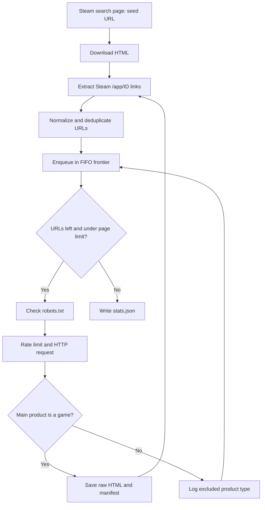

# Consultation 2a — Steam crawler architecture (initial version)

## Goal and scope

Build a small, demonstrable crawler that obtains raw HTML of public Steam game
pages. The prototype does **not** require Docker, a database, game metadata
extraction, or a search index.

## Workflow

## Components

- `config.py`: seed URL, crawl limits, rate limit and output directory.
- `crawler.py`: FIFO queue (`collections.deque`), visited/known sets, HTML parsing,
  HTTP fetching and persistence.
- `main.py`: entry point.

## URL selection

- Seed: English Steam search results sorted by release date with Steam's
  games-only filter (`category1=998`).
- Follow: only `https://store.steampowered.com/app/<numeric_id>/...`.
- Normalize different slugs/query parameters for the same AppID to a single URL.
- Ignore other hosts, item types, and duplicate AppIDs. Product pages are also
  filtered after downloading: DLC and soundtrack page markers are excluded;
  titles ending in `Demo` or `Playtest` are excluded; pages with no recognizable
  main title are excluded. These are HTML heuristics, not a canonical API type.
- The prototype keeps discovered game URLs in a FIFO queue (BFS).

## Politeness and safety

- Read and check Steam `robots.txt` before crawling.
- Abort if `robots.txt` cannot be verified.
- Wait at least four seconds between HTTP requests.
- Stop on HTTP 403/429; do not bypass age checks or rate limits.
- Do not automatically follow redirects (to avoid unverified destinations).
- One worker; bounded at 10 accepted game pages initially.

## Persistence and evidence

Each execution has its own `data/pages/run_*/` directory:

- `seed_search.html` and `app_<id>.html`: original downloaded HTML.
- `manifest.jsonl`: per-page source URL, UTC timestamp, AppID, title, size and result (including exclusions).
- `stats.json`: saved games, excluded product counts, seen/visited URLs, queued URLs, bytes and errors.

No existing downloaded file is overwritten.

## Tests and current limitations

Unit tests validate URL parsing, normalization, deduplication and a simulated
end-to-end crawl. Real live downloads have **not** been executed in this
packaging environment and must be checked on the student's own machine.

Type classification requires maintenance if Steam changes its HTML.
The presence of a demo download widget **does not** exclude a full game.
This version does not execute JavaScript, paginate searches, resume an
interrupted queue, extract structured game fields, or collect the full dataset.
Those are future enhancements once the basic prototype is verified.
